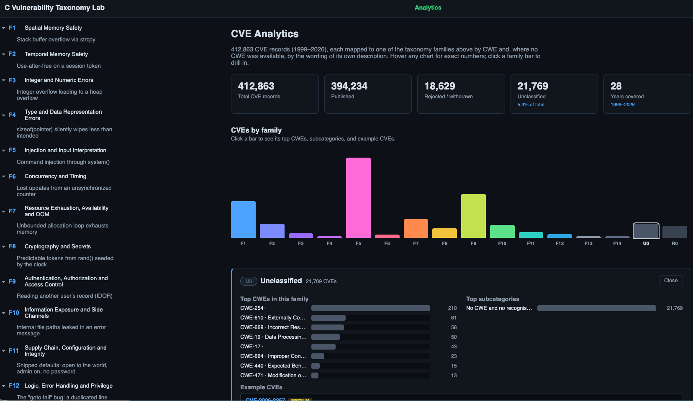
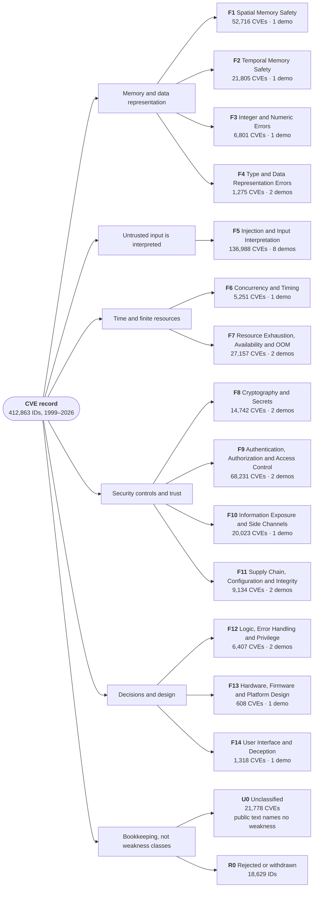

# CVE Weakness Taxonomy Lab

An interactive, self-contained lab for a **14-family taxonomy of weaknesses that covers the whole CVE
record** (412,863 CVE IDs). A family is a root-cause idea -- "untrusted data is interpreted as a command",
"a limit is not enforced", "the code does not check who is allowed" -- so it applies to every language and
every kind of system, not to C. The demos are small, runnable illustrations of each idea. They are written
in **C, JavaScript (Node.js) and Python** because the weaknesses show up in all of them; the language of a
demo is incidental, and each demo says which one it uses.

Browse the taxonomy, open any demo, and run the **vulnerable** and **fixed** versions side by side in a
sandboxed container. C demos run under AddressSanitizer / UndefinedBehaviorSanitizer / ThreadSanitizer;
the others print `[ATTACK SUCCEEDED]` or `[BLOCKED]` so non-crashing bugs (injection, logic, access
control, supply chain) are just as visible as memory corruption.



## The taxonomy at a glance

Every CVE ID in the dataset sits in exactly one box below. The 14 families are root causes ("how the system
went wrong"), grouped here only for reading; the grouping is not a separate level in the data.



The same structure as plain text, with one-line definitions:

```
CVE record (412,863 IDs)
├── Memory and data representation
│   ├── F1  Spatial Memory Safety ............ reads/writes outside an object's bounds
│   ├── F2  Temporal Memory Safety ........... object used when freed, null, or uninitialized
│   ├── F3  Integer and Numeric Errors ....... arithmetic or conversion gives an unexpected number
│   └── F4  Type and Data Representation ..... data interpreted as the wrong type or layout
├── Untrusted input is interpreted
│   └── F5  Injection and Input Interpretation  data run as a command, query, path, markup, code or prompt
├── Time and finite resources
│   ├── F6  Concurrency and Timing ........... bug appears only under some interleaving
│   └── F7  Resource Exhaustion .............. a finite resource is unbounded or never released
├── Security controls and trust
│   ├── F8  Cryptography and Secrets ......... secrets or randomness an attacker can predict or recover
│   ├── F9  Authn, Authz and Access Control .. code does not enforce who may do or see what
│   ├── F10 Information Exposure ............. sensitive data leaks without memory corruption
│   └── F11 Supply Chain, Config, Integrity .. code, data or settings trusted without verification
├── Decisions and design
│   ├── F12 Logic, Error Handling, Privilege . a decision is wrong or skipped
│   ├── F13 Hardware, Firmware, Platform ..... the flaw is in the device's design
│   └── F14 User Interface and Deception ..... works as coded, but the user is misled
└── Bookkeeping (not weakness classes)
    ├── U0  Unclassified ..................... public text names no weakness
    └── R0  Rejected or withdrawn ............ ID describes no vulnerability
```

Language and platform are deliberately **not** levels of this tree. They are filters (Explore tab), because the
same family appears in many of them: F5 is SQL injection in Python, XSS in JavaScript, command injection in C and
prompt injection in an AI agent.

### Every subcategory

<details>
<summary>All 95 subcategories in the data, with CVE counts and demos (click to expand)</summary>

**F1 · Spatial Memory Safety** — 52,716 CVEs, 51 CWEs. *Code reads or writes outside the bounds of the object it was given.*

| Subcategory | CVEs | Demo |
|---|---:|---|
| Out-of-bounds write | 20,601 | none yet |
| Classic buffer overflow (stack/heap) | 11,897 | Stack buffer overflow via strcpy (C) |
| Out-of-bounds read / over-read | 11,099 | none yet |
| Memory corruption (unspecified) | 6,775 | none yet |
| Buffer bounds (generic) | 1,389 | none yet |
| Index / length validation | 822 | none yet |
| Memory bounds error (text-classified) | 105 | none yet |
| Out-of-bounds read/write | 28 | none yet |

**F2 · Temporal Memory Safety** — 21,805 CVEs, 48 CWEs. *An object is used when it is not in a valid state: freed, uninitialized, null, or out of scope.*

| Subcategory | CVEs | Demo |
|---|---:|---|
| Use after free | 10,807 | Use-after-free on a session token (C) |
| NULL / invalid pointer dereference | 7,475 | none yet |
| Uninitialized memory or variable | 1,969 | none yet |
| Double free / invalid free | 1,236 | none yet |
| Memory lifetime error (text-classified) | 203 | none yet |
| Use-after-free / double free | 60 | none yet |
| NULL dereference / uninitialized use | 46 | none yet |
| Dangling stack reference | 9 | none yet |

**F3 · Integer and Numeric Errors** — 6,801 CVEs, 23 CWEs. *Arithmetic or a conversion produces a number the programmer did not expect.*

| Subcategory | CVEs | Demo |
|---|---:|---|
| Integer overflow / wraparound | 5,523 | Integer overflow leading to a heap overflow (C) |
| Divide by zero | 477 | none yet |
| Integer overflow / divide-by-zero | 303 | none yet |
| Incorrect calculation | 262 | none yet |
| Signedness / truncation / conversion | 226 | none yet |
| Integer/numeric error (text-classified) | 10 | none yet |

**F4 · Type and Data Representation Errors** — 1,275 CVEs, 27 CWEs. *Data is interpreted as something it is not: wrong type, size, or layout.*

| Subcategory | CVEs | Demo |
|---|---:|---|
| Type confusion | 979 | Type confusion: a note treated as a user object (C) |
| Incorrect type conversion or cast | 202 | none yet |
| Undefined behavior / data layout | 83 | none yet |
| Wrong sizeof / pointer arithmetic | 8 | sizeof(pointer) silently wipes less than intended (C) |
| Type confusion / wrong data layout | 3 | none yet |

**F5 · Injection and Input Interpretation** — 136,988 CVEs, 195 CWEs. *Untrusted data is interpreted as a command, query, path, markup, code or instruction.*

| Subcategory | CVEs | Demo |
|---|---:|---|
| Cross-site scripting (XSS) | 52,454 | Cross-site scripting through unescaped output (JavaScript) |
| SQL injection | 23,650 | SQL injection through string-built queries (Python) |
| Path traversal / link following | 15,678 | Path traversal out of the web root (JavaScript) |
| OS command / argument injection | 10,469 | Command injection through system() (C) |
| Code injection / eval / template injection | 6,949 | none yet |
| Unrestricted file upload | 4,625 | none yet |
| Generic improper input validation | 4,043 | none yet |
| Server-side request forgery (SSRF) | 3,735 | SSRF through a string-prefix URL allow-list (Python) |
| Unsafe deserialization | 3,537 | Remote code execution through unsafe deserialization (Python) |
| Injection (generic) | 2,998 | none yet |
| File inclusion | 2,741 | none yet |
| Open redirect | 1,924 | none yet |
| XML entity injection (XXE) | 1,469 | none yet |
| Request smuggling / interpretation conflict | 1,021 | none yet |
| Prototype pollution / object property injection | 756 | Prototype pollution through a recursive merge (JavaScript) |
| Format string injection | 723 | none yet |
| Prompt injection / AI agent manipulation | 141 | Prompt injection against an AI agent (toy model) (Python) |
| Injection / input interpretation (text-classified) | 75 | none yet |

**F6 · Concurrency and Timing** — 5,251 CVEs, 39 CWEs. *The bug only appears under a particular timing or interleaving of events.*

| Subcategory | CVEs | Demo |
|---|---:|---|
| Race condition | 3,813 | Lost updates from an unsynchronized counter (C) |
| Locking / deadlock | 783 | none yet |
| Race condition / locking error | 377 | none yet |
| Insecure temporary file | 199 | none yet |
| Race / timing error (text-classified) | 79 | none yet |

**F7 · Resource Exhaustion, Availability and OOM** — 27,157 CVEs, 86 CWEs. *A finite resource is unbounded or never released.*

| Subcategory | CVEs | Demo |
|---|---:|---|
| Uncontrolled resource consumption / DoS | 13,690 | none yet |
| Memory / resource leak | 3,551 | none yet |
| Infinite loop / excessive iteration | 3,181 | none yet |
| Memory allocation without limits (OOM) | 3,146 | Unbounded allocation loop exhausts memory (C) |
| Reachable assertion / abort | 1,031 | none yet |
| Algorithmic complexity / ReDoS | 771 | Regular-expression denial of service (ReDoS) (JavaScript) |
| Memory/resource leak or exhaustion | 736 | none yet |
| Uncontrolled recursion / stack exhaustion | 696 | none yet |
| Decompression bomb / amplification | 255 | none yet |
| Resource exhaustion (text-classified) | 100 | none yet |

**F8 · Cryptography and Secrets** — 14,742 CVEs, 111 CWEs. *Secrets or randomness are handled in a way an attacker can predict or recover.*

| Subcategory | CVEs | Demo |
|---|---:|---|
| Hard-coded or default credentials / keys | 4,585 | Hard-coded credentials in a shipped artifact (Python) |
| Certificate / TLS validation | 3,855 | none yet |
| Cleartext storage or transmission | 3,050 | none yet |
| Cryptographic issues (generic) | 2,152 | none yet |
| Weak / predictable randomness | 830 | Predictable tokens from rand() seeded by the clock (C) |
| Cryptography/secrets weakness (text-classified) | 149 | none yet |
| Nonce / IV / key management | 121 | none yet |

**F9 · Authentication, Authorization and Access Control** — 68,231 CVEs, 137 CWEs. *The code does not enforce who is allowed to do or see what.*

| Subcategory | CVEs | Demo |
|---|---:|---|
| Missing or incorrect authorization | 22,153 | Reading another user's record (IDOR) (C) |
| Permissions and privilege assignment | 12,307 | none yet |
| Missing or improper authentication | 10,993 | none yet |
| Cross-site request forgery (CSRF) | 9,603 | Cross-site request forgery against a logged-in user (JavaScript) |
| Access control (generic) | 9,071 | none yet |
| Brute force / weak password policy | 1,706 | none yet |
| Session management | 1,525 | none yet |
| Access-control weakness (text-classified) | 698 | none yet |
| Cross-origin / policy bypass | 127 | none yet |
| Missing/incorrect authorization | 48 | none yet |

**F10 · Information Exposure and Side Channels** — 20,023 CVEs, 95 CWEs. *Sensitive data leaks without any memory corruption.*

| Subcategory | CVEs | Demo |
|---|---:|---|
| Sensitive information exposure | 16,614 | none yet |
| Secrets in logs / errors | 1,801 | Internal file paths leaked in an error message (C) |
| Timing and observable discrepancy | 1,221 | none yet |
| Information exposure (text-classified) | 326 | none yet |
| Speculative-execution / microarchitectural side channel | 61 | none yet |

**F11 · Supply Chain, Configuration and Integrity** — 9,134 CVEs, 82 CWEs. *The program trusts code, data, or settings it should not.*

| Subcategory | CVEs | Demo |
|---|---:|---|
| Missing integrity or authenticity verification | 3,640 | Update installed without verifying its integrity (Python) |
| Untrusted search path / library loading | 2,761 | none yet |
| Insecure default / configuration / debug | 1,622 | Shipped defaults: open to the world, admin on, no password (C) |
| Untrusted component / dependency / backdoor | 1,038 | none yet |
| Configuration/integrity weakness (text-classified) | 73 | none yet |

**F12 · Logic, Error Handling and Privilege** — 6,407 CVEs, 97 CWEs. *A decision is wrong or skipped: an error is ignored or a branch misbehaves.*

| Subcategory | CVEs | Demo |
|---|---:|---|
| Incorrect control flow or logic | 3,860 | Business-logic flaw: negative quantity in a cart (JavaScript); The "goto fail" bug: a duplicated line skips verification (C) |
| Unchecked or mishandled error / exception | 1,723 | none yet |
| OS privilege mismanagement | 615 | none yet |
| Logic/error-handling flaw (text-classified) | 209 | none yet |

**F13 · Hardware, Firmware and Platform Design** — 608 CVEs, 79 CWEs. *The flaw is in the design of the device or platform, not in one line of code.*

| Subcategory | CVEs | Demo |
|---|---:|---|
| Hardware / firmware design weakness | 608 | Debug port left enabled on a production device (C) |

**F14 · User Interface and Deception** — 1,318 CVEs, 19 CWEs. *The program works as coded but the user is misled about what is happening.*

| Subcategory | CVEs | Demo |
|---|---:|---|
| UI misrepresentation / spoofing | 746 | Forged status line via newline injection in displayed text (C) |
| Clickjacking / UI redress | 523 | none yet |
| UI deception (text-classified) | 49 | none yet |

</details>

## Are all CVEs covered?

Yes, for the 412,863 records in this dataset. This is checked, not asserted:

| Check | Result |
|---|---|
| CVE IDs in the CSV | 412,863, all unique, all of the form `CVE-YYYY-NNNN+` |
| Rows with no family, or an unknown family | 0 |
| Sum of the 16 buckets | 412,863 = total, so nothing is dropped and nothing is counted twice |
| Classified rows (F1–F14) with no subcategory | 0 of 372,456 |
| Distinct CWEs in the data | 788, every one assigned to a family |

Re-run it yourself:

```bash
python3 - <<'PY'
import pandas as pd
b = pd.read_csv("cve_family_mapping_v4.csv", usecols=["cve_id","family_id","subcategory"], dtype=str, na_filter=False)
ok = {f"F{i}" for i in range(1,15)} | {"U0","R0"}
assert b.cve_id.is_unique and b.cve_id.str.match(r"^CVE-\d{4}-\d{4,}$").all()
assert b.family_id.isin(ok).all() and b.family_id.value_counts().sum() == len(b)
assert (b[~b.family_id.isin(["U0","R0"])].subcategory != "").all()
print("all", len(b), "CVEs covered exactly once")
PY
```

What "covered" does **not** mean:

- **Covered is not the same as correctly classified.** 79.3% of classified CVEs are placed by a specific CWE;
  the others rest on weaker evidence and are marked `medium` or `low` in `mapping_confidence`.
- **21,778 CVEs (5.3%) are U0** because their public text names no weakness. They are
  covered (they have a bucket and a `best_guess_family`) but not assigned to a family.
- **The dataset is a snapshot.** Coverage is verified for the records in this CSV; I could not check it against
  the live CVE Program feed, and CVEs published later are not included. New records need `tools/` re-run.
- **A new kind of weakness could appear.** If a future CVE fits no family it would land in U0 or in the
  nearest family's generic subcategory, which is why U0 is reported openly rather than hidden.

## Quick start

Requires Docker and Docker Compose (the `docker compose` plugin, not the old `docker-compose` standalone).

```bash
./up      # builds and starts everything, prints the address when ready
./down    # stops the lab (keeps images, fast restart)
./clean   # stops everything and deletes containers, volumes and images
./logs    # watch live logs (Ctrl+C to exit)
```

(`make up`, `make down`, `make clean` still work too.) Then open **http://localhost:8080**.

## The tabs

- **Home**: the 14 families, where each one shows up (languages, ecosystems, device types), real CVEs
  that exemplify it, and a table showing that *domains* (web, native, mobile, cloud, IoT/ICS, AI,
  supply chain) cut across families.
- **Analytics**: counts per family over time, by severity, vendor and product, with drill-down.
- **Explore**: filter all CVEs by **operating system**, **programming language**, **system type**,
  weakness family, year range, minimum severity and evidence strength. Chips show live counts; results
  show the families, most common subcategories (each linked to a runnable demo when one exists), top
  CWEs, vendors, trend, severity and a stable sample of matching CVEs. Filters are URL-shareable
  (`#/explore?os=linux&lang=c_cpp&family=F1,F2`).
- **Coverage**: "does this cover all of CVE?" answered with data: every subcategory in the record, its
  size, how strong the evidence behind it is, whether a demo covers it, and a crosswalk to MITRE's ten
  top-level CWE pillars.

### How the Explore filters work (read this before quoting a number)

The CVE record has no "operating system" or "language" field. These facets are **inferred** from vendor,
product, assigner and description wording (plus short hand-written lists such as WordPress -> PHP). The
rules are in `tools/facet_rules.py`; nothing is guessed for a CVE that names nothing. Measured coverage:
about **19%** of records name an operating system, **39%** point at a programming language and **69%** fit
a system type, so a filter can only see the records that say something. A value like "PHP" means *the
record points at PHP code*; wording-based rules also have false positives (a description that merely
mentions a browser is counted as "browser"). One CVE can carry several values per group. Counts were
cross-checked against an independent recomputation.

### How complete is the CVE mapping?

- **Every CVE record appears exactly once** (see *Are all CVEs covered?* above).
- Each CVE is mapped to one family by its CWE (NVD/CNA) where available, otherwise by description
  keywords. **79%** of the 372,456 classified CVEs were placed by a *specific* CWE (high confidence).
  The weaker bases (umbrella CWEs refined by wording, keywords, hierarchy inheritance, a text classifier,
  Linux commit titles) are marked `medium` or `low` in `mapping_confidence`; the Coverage tab shows the split.
- **21,778 (5.3%) are `U0` Unclassified**: the public text names no weakness. 7,599 are vendor advisories
  (mostly Oracle bulletins), 12,094 are too vague for the classifier, and 2,085 were moved here by the v4
  repair because they were labelled "memory corruption" only on the strength of the phrase "execute arbitrary
  code", which is an impact, not a weakness (CVEs with a specific CWE and the same wording are ~56% injection
  and only ~21% memory bugs). The CSV gives a `best_guess_family` for U0 rows, kept out of the counts.
- **18,629 are `R0` Rejected/Withdrawn** CVE IDs.
- 1,612 Linux-kernel CVEs were recovered from the commit title and 2,076 more by a text classifier
  (about 88% accurate on a held-out set of clear descriptions, lower on vague ones); all are `low`.
- The dataset is a snapshot: later CVEs are not included.
- **What "covered by a demo" means**: 14 of 14 families and 26 of 95 subcategories (about 53% of classified
  CVEs) have a runnable demo. The rest are listed on the Coverage tab as "no demo yet" rather than hidden.

## Data and tooling (`tools/`)

Everything shipped in the dashboard can be rebuilt from the mapping CSV:

```bash
python3 tools/repair_mapping.py  cve_family_mapping_v3.csv cve_family_mapping_v4.csv repair_changelog_v3_to_v4.csv
python3 tools/build_analytics.py cve_family_mapping_v4.csv backend/analytics/analytics.json
(cd tools && npm install) && python3 tools/build_facets.py cve_family_mapping_v4.csv backend/analytics
```

`docs/MAPPING_V4.md` explains what the v3 -> v4 repair changed and why; `repair_changelog_v3_to_v4.csv`
lists every changed row (7,284) so any change can be audited or reverted. `backend/taxonomy.json` is the single
source of truth for family names, definitions and cross-language notes.

## Tests

```bash
cd backend && npm test                        # all 27 demos: the bug appears, the fix holds
cd backend && PORT=4010 node server.js &      # then:
cd frontend && npm test                       # renders Home / Explore / Coverage / a demo against the live API
```

## How to navigate (you will never be lost)

- **Left sidebar**: the full taxonomy tree, families F1-F14, each expandable to its demos (with language tags).
  The demo you're viewing is always highlighted.
- **Top bar**: permanent links to Home, Analytics, Explore, Coverage and "How this works".
- **Breadcrumb**: every demo page shows `Family . Subcategory` above its title.
- **Prev / Next**: linear walkthrough buttons at the bottom of every demo.
- **URLs are shareable**: every demo and every filter has its own `#/...` address.
- If a demo ID doesn't exist, the page says so plainly and links home instead of showing a blank screen.

## What "run in sandbox" actually does

1. The backend picks **one of a fixed set of demo files that ship with this repo** (C, JavaScript or
   Python), never code typed into the browser. C files are compiled with `-fsanitize=address,undefined`
   (or `thread` for the concurrency demo); JavaScript and Python files run directly.
2. It runs the program as a non-root user with a hard timeout and a process limit (and, for C, a capped
   virtual-memory limit). The backend container is on an internal Docker network with no route to the internet.
3. stdout, stderr, the sanitizer's report (if any), the `[ATTACK SUCCEEDED]` / `[BLOCKED]` verdict, the
   exit code and the timing come back and are shown next to the code.

See `SECURITY.md` for the full list of protections and their honest limitations.

## Project layout

```
cve-lab/
  up down clean logs       one-word launcher scripts
  Makefile                 same commands via make
  docker-compose.yml       backend + frontend services, resource limits, internal network
  backend/                 Node/Express API that runs the demos and serves the data
    taxonomy.json          single source of truth: families, definitions, domains, CWE pillars
    runner.js              runs C (sanitizers), JavaScript (node) and Python (python3) demos
    facets.js              live OS / language / system-type filtering
    test_demos.js          asserts every demo's bug appears and its fix holds
    demos/<id>/
      meta.json            title, language, CWE, CVE-data subcategory, root cause, defenses, expectations
      vulnerable.<c|js|py>
      fixed.<c|js|py>
    analytics/             analytics.json, facets.bin.gz, facets.meta.json (built by tools/)
  frontend/                React (Vite) single-page app, served by nginx; `npm test` = render tests
  tools/                   repair_mapping.py, build_analytics.py, build_facets.py + their rules
  docs/MAPPING_V4.md       what the v3 -> v4 repair changed, and how it was checked
```

## Adding a new demo

1. Make a new folder under `backend/demos/<your-id>/`.
2. Add `vulnerable.<ext>` and `fixed.<ext>` (`c`, `js` or `py`). Each is a small, self-contained program
   that prints what it is doing in plain language. For non-crashing bugs, print `[ATTACK SUCCEEDED]` in
   the vulnerable version and `[BLOCKED]` in the fixed one.
3. Add `meta.json`. `csv_subcategory` must be an existing subcategory name from the Coverage tab, so the
   demo links to the CVEs it illustrates; `expect` tells `npm test` what to look for (`"SANITIZER"` for C
   demos that trip a sanitizer, `"VERDICT"` for the markers above, or a regular expression):

```json
{
  "family": "F5",
  "family_name": "Injection and Input Interpretation",
  "language": "python",
  "subcategory": "SQL injection",
  "csv_subcategory": "SQL injection",
  "cwe": "CWE-89",
  "title": "SQL injection through string-built queries",
  "root_cause": "One sentence explaining the broken invariant.",
  "defenses": ["Concrete defense 1", "Concrete defense 2"],
  "expect": { "vulnerable": "VERDICT", "fixed": "VERDICT" },
  "timeout_s": 5
}
```

4. Run `cd backend && npm test`.
